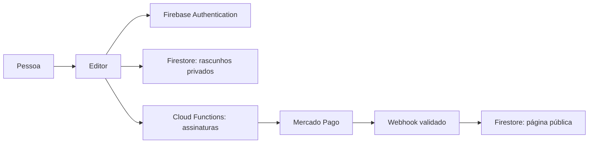

# AgendaFácil

Construtor de páginas para pequenos negócios, com editor visual, rascunhos privados e uma integração de assinaturas em desenvolvimento.


**Estado:** desenvolvimento e homologação. A versão local tem **230 testes aprovados**. O fluxo externo de pagamento ainda precisa de validação no Mercado Pago. A agenda apresentada nas páginas é uma prévia: reservas reais de horários ainda não foram implementadas.

**Entrega de 09/11/2026:** demonstração em modo Spark publicada e verificada no Firebase, com cadastro, login e rascunhos privados. Os 18 recursos publicados foram conferidos contra a versão validada. Pagamentos permanecem desativados; o repositório continua usando apenas configuração demo.

## O que já funciona

- Cadastro, login e recuperação de senha com Firebase Authentication.
- Editor com cores, identidade do negócio, horários e prévia da página.
- Rascunhos privados no Firestore, com validação e controle de acesso nas regras.
- Prévia local isolada usando um projeto fictício e os emuladores do Firebase.
- Backend de assinaturas com webhook assinado, controle de duplicidade, recuperação de falhas e tratamento de cancelamento e estorno.

Os testes financeiros usam um gateway simulado. A existência do backend não significa que pagamentos estejam habilitados no site.

## Executar no computador

Requisitos: **Node.js 22** e **Java 21 ou superior**.

```sh
npm ci --ignore-scripts
npm --prefix functions ci --ignore-scripts
npm run preview
```

Abra **http://127.0.0.1:5000/login.html** e crie uma conta fictícia. No Windows, também é possível abrir `ABRIR-PREVIA.cmd` após instalar os requisitos.

A prévia usa `demo-agendafacil`, não precisa de cartão ou login no Google e não grava no Firebase publicado. Links de confirmação e recuperação aparecem no terminal do emulador. Os dados são descartados ao encerrar. O primeiro uso baixa ferramentas; as páginas carregam SDKs e fontes pela internet.

## Validar

```sh
npm run check:publication
npm run check:assets
npm test
npm audit
npm --prefix functions audit
```

São 210 testes unitários, 18 testes de regras/transações e dois cenários integrados com Authentication, Firestore e Hosting emulados. A verificação no GitHub executa os mesmos grupos sem segredos e sem deploy. Sua execução remota pode ser acompanhada em **Actions**.

## Organização

| Pasta | Responsabilidade |
|---|---|
| `public/` | Páginas, editor, renderização e persistência de rascunhos |
| `functions/` | Validação no servidor, assinaturas e webhook |
| `tests/` | Testes unitários, regras e fluxos nos emuladores |
| `scripts/` | Prévia local e verificações anteriores à publicação |
| `docs/` | Arquitetura, evolução e roteiro de lançamento |



## Segurança e publicação

Este repositório usa configuração fictícia. Tokens, contas de serviço, configurações de ambientes reais, relatórios internos e dados de usuários não fazem parte da entrega. As Functions recebem os segredos pelo Secret Manager; o navegador nunca recebe o token do Mercado Pago.

- [Arquitetura e decisões](docs/ARQUITETURA.md)
- [Como colocar no ar](docs/LANCAMENTO.md)
- [Próximas entregas](ROADMAP.md)
- [Registro de evolução](CHANGELOG.md)
- [Cuidados com informações sensíveis](SECURITY.md)

O objetivo das próximas entregas é validar o fluxo externo de assinatura e preparar a primeira versão pública utilizável. Não há licença de uso ou redistribuição definida neste momento.
